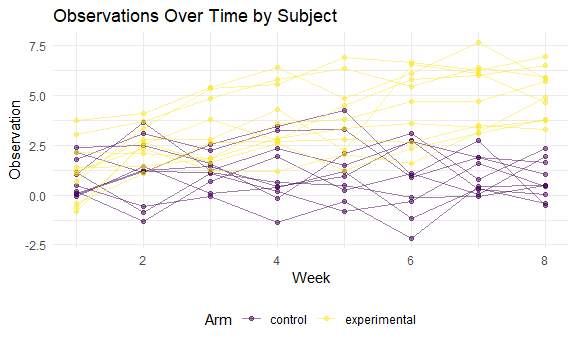
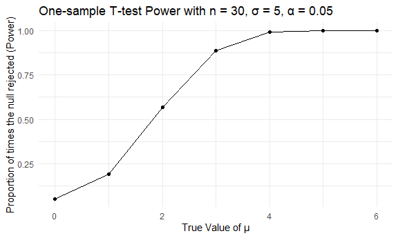
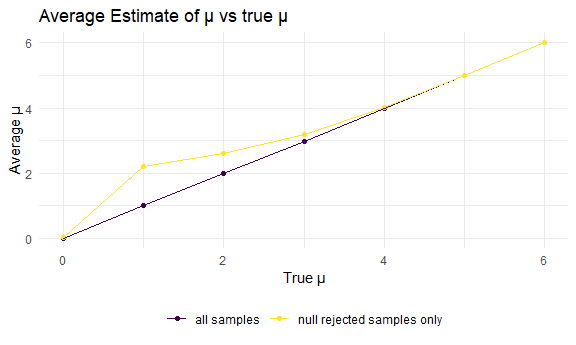

HW5_cmh2275
================
cmh2275
2026-11-15

## Problem 1

``` r
brithday_results_df = 
  expand_grid(
    number_of_people = rep(2:50), 
    iter = 1:1000
  )|>
  mutate(
    repeated = map_lgl(number_of_people, birthday_repeated)
  )


brithday_results_df |>
  group_by(number_of_people)|>
  summarize(prob_of_repeat = mean(repeated))|>
  ggplot(aes(x=number_of_people, y = prob_of_repeat))+
  geom_point()+
  geom_line()
```


The probability of 2 people having the same birth is around 50 percent
between 22 and 23 people. If there are 50 people in a room, the
probability is close to, but not exactly, 100 percent.

## Problem 2

Import & tidy

``` r
study_df = 
  tibble(file_name = list.files("data", pattern = "\\.csv$"))|>
  mutate(
    data = map(file.path("data", file_name), read_csv)
  )|>
  unnest(data)|>
  mutate(
    file_name = str_remove(file_name, "\\.csv$")
    )|>
  separate (
    file_name, into = c("arm", "subject_id"), sep = "_"
    )|>
  mutate (
    arm = recode(arm, con = "control", exp = "experimental"), 
    arm = fct_relevel(arm, "control", "experimental"),
    subject_id = str_c(arm, "_", subject_id)
  )|>
  pivot_longer (
    cols = starts_with("week_"), 
    names_to = "week", 
    names_prefix = "week_", 
    values_to = "obs"
  )|>
  mutate (
    week = as.numeric(week)
  )|>
  select(
    subject_id, arm, week, obs
  )
```

    ## Rows: 1 Columns: 8
    ## ── Column specification ────────────────────────────────────────────────────────
    ## Delimiter: ","
    ## dbl (8): week_1, week_2, week_3, week_4, week_5, week_6, week_7, week_8
    ## 
    ## ℹ Use `spec()` to retrieve the full column specification for this data.
    ## ℹ Specify the column types or set `show_col_types = FALSE` to quiet this message.
    ## Rows: 1 Columns: 8
    ## ── Column specification ────────────────────────────────────────────────────────
    ## Delimiter: ","
    ## dbl (8): week_1, week_2, week_3, week_4, week_5, week_6, week_7, week_8
    ## 
    ## ℹ Use `spec()` to retrieve the full column specification for this data.
    ## ℹ Specify the column types or set `show_col_types = FALSE` to quiet this message.
    ## Rows: 1 Columns: 8
    ## ── Column specification ────────────────────────────────────────────────────────
    ## Delimiter: ","
    ## dbl (8): week_1, week_2, week_3, week_4, week_5, week_6, week_7, week_8
    ## 
    ## ℹ Use `spec()` to retrieve the full column specification for this data.
    ## ℹ Specify the column types or set `show_col_types = FALSE` to quiet this message.
    ## Rows: 1 Columns: 8
    ## ── Column specification ────────────────────────────────────────────────────────
    ## Delimiter: ","
    ## dbl (8): week_1, week_2, week_3, week_4, week_5, week_6, week_7, week_8
    ## 
    ## ℹ Use `spec()` to retrieve the full column specification for this data.
    ## ℹ Specify the column types or set `show_col_types = FALSE` to quiet this message.
    ## Rows: 1 Columns: 8
    ## ── Column specification ────────────────────────────────────────────────────────
    ## Delimiter: ","
    ## dbl (8): week_1, week_2, week_3, week_4, week_5, week_6, week_7, week_8
    ## 
    ## ℹ Use `spec()` to retrieve the full column specification for this data.
    ## ℹ Specify the column types or set `show_col_types = FALSE` to quiet this message.
    ## Rows: 1 Columns: 8
    ## ── Column specification ────────────────────────────────────────────────────────
    ## Delimiter: ","
    ## dbl (8): week_1, week_2, week_3, week_4, week_5, week_6, week_7, week_8
    ## 
    ## ℹ Use `spec()` to retrieve the full column specification for this data.
    ## ℹ Specify the column types or set `show_col_types = FALSE` to quiet this message.
    ## Rows: 1 Columns: 8
    ## ── Column specification ────────────────────────────────────────────────────────
    ## Delimiter: ","
    ## dbl (8): week_1, week_2, week_3, week_4, week_5, week_6, week_7, week_8
    ## 
    ## ℹ Use `spec()` to retrieve the full column specification for this data.
    ## ℹ Specify the column types or set `show_col_types = FALSE` to quiet this message.
    ## Rows: 1 Columns: 8
    ## ── Column specification ────────────────────────────────────────────────────────
    ## Delimiter: ","
    ## dbl (8): week_1, week_2, week_3, week_4, week_5, week_6, week_7, week_8
    ## 
    ## ℹ Use `spec()` to retrieve the full column specification for this data.
    ## ℹ Specify the column types or set `show_col_types = FALSE` to quiet this message.
    ## Rows: 1 Columns: 8
    ## ── Column specification ────────────────────────────────────────────────────────
    ## Delimiter: ","
    ## dbl (8): week_1, week_2, week_3, week_4, week_5, week_6, week_7, week_8
    ## 
    ## ℹ Use `spec()` to retrieve the full column specification for this data.
    ## ℹ Specify the column types or set `show_col_types = FALSE` to quiet this message.
    ## Rows: 1 Columns: 8
    ## ── Column specification ────────────────────────────────────────────────────────
    ## Delimiter: ","
    ## dbl (8): week_1, week_2, week_3, week_4, week_5, week_6, week_7, week_8
    ## 
    ## ℹ Use `spec()` to retrieve the full column specification for this data.
    ## ℹ Specify the column types or set `show_col_types = FALSE` to quiet this message.
    ## Rows: 1 Columns: 8
    ## ── Column specification ────────────────────────────────────────────────────────
    ## Delimiter: ","
    ## dbl (8): week_1, week_2, week_3, week_4, week_5, week_6, week_7, week_8
    ## 
    ## ℹ Use `spec()` to retrieve the full column specification for this data.
    ## ℹ Specify the column types or set `show_col_types = FALSE` to quiet this message.
    ## Rows: 1 Columns: 8
    ## ── Column specification ────────────────────────────────────────────────────────
    ## Delimiter: ","
    ## dbl (8): week_1, week_2, week_3, week_4, week_5, week_6, week_7, week_8
    ## 
    ## ℹ Use `spec()` to retrieve the full column specification for this data.
    ## ℹ Specify the column types or set `show_col_types = FALSE` to quiet this message.
    ## Rows: 1 Columns: 8
    ## ── Column specification ────────────────────────────────────────────────────────
    ## Delimiter: ","
    ## dbl (8): week_1, week_2, week_3, week_4, week_5, week_6, week_7, week_8
    ## 
    ## ℹ Use `spec()` to retrieve the full column specification for this data.
    ## ℹ Specify the column types or set `show_col_types = FALSE` to quiet this message.
    ## Rows: 1 Columns: 8
    ## ── Column specification ────────────────────────────────────────────────────────
    ## Delimiter: ","
    ## dbl (8): week_1, week_2, week_3, week_4, week_5, week_6, week_7, week_8
    ## 
    ## ℹ Use `spec()` to retrieve the full column specification for this data.
    ## ℹ Specify the column types or set `show_col_types = FALSE` to quiet this message.
    ## Rows: 1 Columns: 8
    ## ── Column specification ────────────────────────────────────────────────────────
    ## Delimiter: ","
    ## dbl (8): week_1, week_2, week_3, week_4, week_5, week_6, week_7, week_8
    ## 
    ## ℹ Use `spec()` to retrieve the full column specification for this data.
    ## ℹ Specify the column types or set `show_col_types = FALSE` to quiet this message.
    ## Rows: 1 Columns: 8
    ## ── Column specification ────────────────────────────────────────────────────────
    ## Delimiter: ","
    ## dbl (8): week_1, week_2, week_3, week_4, week_5, week_6, week_7, week_8
    ## 
    ## ℹ Use `spec()` to retrieve the full column specification for this data.
    ## ℹ Specify the column types or set `show_col_types = FALSE` to quiet this message.
    ## Rows: 1 Columns: 8
    ## ── Column specification ────────────────────────────────────────────────────────
    ## Delimiter: ","
    ## dbl (8): week_1, week_2, week_3, week_4, week_5, week_6, week_7, week_8
    ## 
    ## ℹ Use `spec()` to retrieve the full column specification for this data.
    ## ℹ Specify the column types or set `show_col_types = FALSE` to quiet this message.
    ## Rows: 1 Columns: 8
    ## ── Column specification ────────────────────────────────────────────────────────
    ## Delimiter: ","
    ## dbl (8): week_1, week_2, week_3, week_4, week_5, week_6, week_7, week_8
    ## 
    ## ℹ Use `spec()` to retrieve the full column specification for this data.
    ## ℹ Specify the column types or set `show_col_types = FALSE` to quiet this message.
    ## Rows: 1 Columns: 8
    ## ── Column specification ────────────────────────────────────────────────────────
    ## Delimiter: ","
    ## dbl (8): week_1, week_2, week_3, week_4, week_5, week_6, week_7, week_8
    ## 
    ## ℹ Use `spec()` to retrieve the full column specification for this data.
    ## ℹ Specify the column types or set `show_col_types = FALSE` to quiet this message.
    ## Rows: 1 Columns: 8
    ## ── Column specification ────────────────────────────────────────────────────────
    ## Delimiter: ","
    ## dbl (8): week_1, week_2, week_3, week_4, week_5, week_6, week_7, week_8
    ## 
    ## ℹ Use `spec()` to retrieve the full column specification for this data.
    ## ℹ Specify the column types or set `show_col_types = FALSE` to quiet this message.

``` r
study_df
```

    ## # A tibble: 160 × 4
    ##    subject_id arm      week   obs
    ##    <chr>      <fct>   <dbl> <dbl>
    ##  1 control_01 control     1  0.2 
    ##  2 control_01 control     2 -1.31
    ##  3 control_01 control     3  0.66
    ##  4 control_01 control     4  1.96
    ##  5 control_01 control     5  0.23
    ##  6 control_01 control     6  1.09
    ##  7 control_01 control     7  0.05
    ##  8 control_01 control     8  1.94
    ##  9 control_02 control     1  1.13
    ## 10 control_02 control     2 -0.88
    ## # ℹ 150 more rows

Spagetti Plot

``` r
study_df|>
  ggplot(aes(x = week, y = obs, group = subject_id, color = arm))+
  geom_line(alpha = 0.5)+
  geom_point(alpha = 0.5)+
  labs(
    title = "Observations Over Time by Subject", 
    x = "Week", 
    y = "Observation", 
    color = "Arm"
  )
```



Observation values in the experimental group seemed to generally
increase over weeks 1 to 8, while the control groups observations stated
relatively stable, with some variability, over the weeks compared to the
experimental group.

## Problem 3

``` r
set.seed(1)
```

Function

``` r
ttest_sim = function(mu, n = 30, sigma = 5) {
  x = rnorm(n, mean = mu, sd = sigma)
  t.test(x, mu = 0)|>
    broom::tidy()|>
    select(mu_hat = estimate, p_val = p.value)
}
```

Run Sim

``` r
ttest_sim_results = 
  expand_grid(
    true_mu = 0:6, 
    iter = 1:5000
  )|>
  mutate(results = map(true_mu, ttest_sim))|>
           unnest(results) |>
           mutate(reject = p_val < 0.05)
```

``` r
ttest_sim_sum = 
  ttest_sim_results |>
  group_by (true_mu)|>
  summarize (
    power = mean(reject), 
    avg_mu_hat = mean(mu_hat), 
    avg_mu_hat_reject = mean(mu_hat[reject])
  )
```

first plot

``` r
ttest_sim_sum |>
  ggplot(aes(x = true_mu, y = power))+
  geom_point()+
  geom_line()+
  labs(
    title = "One-sample T-test Power with n = 30, σ = 5, α = 0.05", 
    x = "True Value of μ", 
    y = "Proportion of times the null rejected (Power)"
  )
```



Power increases as μ increases, steeply after μ=1 until about μ=4 at
which point it increases to just about 1.00 for μ\<4.

second plot

``` r
ttest_sim_sum |>
  pivot_longer(
    c(avg_mu_hat, avg_mu_hat_reject), 
    names_to = "sample", 
    values_to = "avg_estimate"
  )|>
  mutate (
    sample = recode(sample,
                    avg_mu_hat = "all samples", 
                    avg_mu_hat_reject = "null rejected samples only")
  )|>
  
  ggplot(aes(x = true_mu, y = avg_estimate, color = sample))+
  geom_point()+
  geom_line()+
  labs(
    title = "Average Estimate of μ vs true μ", 
    x = "True μ", 
    y = "Average μ", 
    color = NULL
  )
```



The average of μ for samples where the null is rejected is not
approximately equal to the true value of μ when μ is low, meaning when
power is low, but the average of μ in rejected samples is close to the
true μ for larger values of μ, starting around μ \<3 or when power is
high. When power is high, more samples are rejected so estimate bias is
less.
