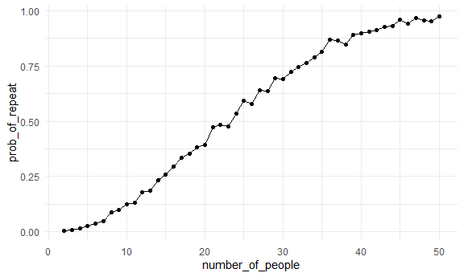

HW5_cmh2275
================
cmh2275
2026-11-15

## Problem 1

``` r
brithday_results_df = 
  expand_grid(
    number_of_people = rep(2:50), 
    iter = 1:1000
  )|>
  mutate(
    repeated = map_lgl(number_of_people, birthday_repeated)
  )


brithday_results_df |>
  group_by(number_of_people)|>
  summarize(prob_of_repeat = mean(repeated))|>
  ggplot(aes(x=number_of_people, y = prob_of_repeat))+
  geom_point()+
  geom_line()
```


